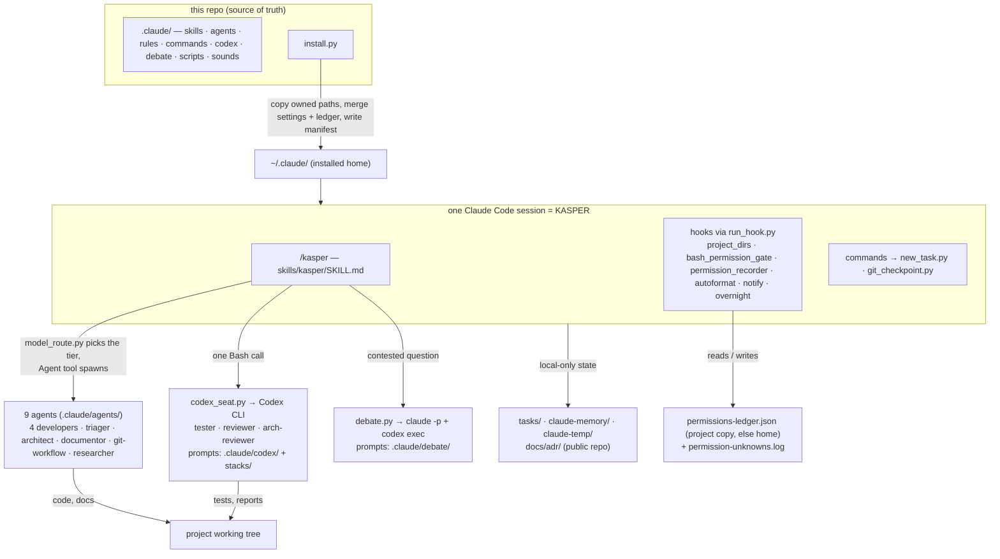

# KASPER — architecture

- **Status:** current as of 2026-10-24 (task 024). A map, not a manual: every path below exists
  in this checkout and carries its own detail in its docstring or header.
- **Design specs:** `docs/design/kasper-v2.md` (the verify loop, overnight mode, the triager),
  `docs/design/debate-seats.md` (the debate). Decision records live in `docs/adr/`, which this
  public repo keeps local-only — named here, never linked.

## What KASPER is

KASPER is a Claude Code configuration — two skills, nine agent definitions, eight rules, six
commands, a permission ledger and twelve stdlib-only Python scripts — that turns one Claude Code
session into a project's orchestrator. That session delegates work to **subagents** (the Agent
tool) and verification to **seats** on a second vendor's CLI (OpenAI Codex), so the writer never
grades its own work. Chain law: human → KASPER → agents, one hop; agents cannot spawn agents,
message each other, or ask the human — a fork stops the agent, KASPER asks and resumes it.

This repository is KASPER's only home: everything that *is* KASPER sits under `.claude/`, and
`install.py` copies it into `~/.claude/` so it governs every project on the machine.

## The parts

### `install.py` → the home copy

`python3 install.py` (stdlib only, Python 3.12+) copies the **owned paths** — `OWNED_PATHS` =
`agents codex commands debate rules scripts skills sounds CLAUDE.md` — verbatim from `.claude/`
into `~/.claude/`, rendering the interpreter name into hook commands per platform. Two files are
**merged, never owned**: `.claude/settings.json` (`merge_settings`: KASPER's own hooks replaced,
`permissions.allow`/`deny` unioned, any other top-level key seeded only when the home lacks it) and
`.claude/permissions-ledger.json` (`merge_ledger`: seed rules added, the machine's `grants` and
`denials` left alone). Details: those two docstrings. Anything about to change is
copied into `~/.claude/kasper-backup-<UTC>/` first, and `~/.claude/kasper-manifest.json` records
the hash of each **owned** file written plus the `source` checkout — the merged files are not
hashed. `--dry-run` prints the plan; `--status` reports owned-file drift against the manifest and
whether the hooks are still wired (exit 0 clean, 1 drift or error); `--uninstall` removes what
the manifest records, keeping anything edited since.

### Hooks — `.claude/settings.json` → `.claude/scripts/run_hook.py` → one script

Every hook command is `python3 "$HOME/.claude/scripts/run_hook.py" <name>`: the dispatcher
`runpy`s `~/.claude/scripts/<name>.py` in-process, so the target reads the payload on stdin and
owns the exit code. The project's own `.claude/scripts/<name>.py` runs instead **only in the source
repo the manifest records** — a clone cannot swap in its own gate. A dispatch failure exits 1,
never 2 (2 would block the call).

| event | script | does |
|---|---|---|
| SessionStart | `.claude/scripts/project_dirs.py` | creates `claude-memory/` and `claude-temp/`, links the harness memory dir (`~/.claude/projects/<slug>/memory`) at `claude-memory/`, excludes `claude-memory/`, `claude-temp/`, `tasks/` — plus `docs/adr/` unless `gh` reports `PRIVATE` — in `.git/info/exclude`, creates `claude-temp/sessions/<id>/` and prints it into context |
| PreToolUse · Bash | `.claude/scripts/bash_permission_gate.py` | decomposes the command and answers from the ledger: guard hit → `ask`; every part allowed → `allow`; unknown → no decision (the native prompt) plus a line in `permission-unknowns.log` beside the ledger in use. Never blocks |
| PostToolUse · Bash | `.claude/scripts/permission_recorder.py` | an approved unknown becomes a `grants` entry in the ledger in use; never for guard hits, destructive/outward heads (`rm`, `curl`, `ssh`, …), or outside the modes where the human is prompted |
| PostToolUse · Edit/Write | `.claude/scripts/autoformat.py` | `ruff` import sort + format on a Python file; exits 0 regardless |
| Notification, Stop | `.claude/scripts/notify.py` | one native OS sound per event, `.claude/sounds/notify.wav` as fallback; exits 0 regardless |
| Stop | `.claude/scripts/overnight.py` | when `tasks/BACKLOG.md` says `overnight: on` for this session and no ending marker exists, blocks the stop with the next item until the backlog is empty, `until` passes, or `MAX_CONTINUATIONS` (60) is reached; silent by day |

**The ledger in use** is the project's `.claude/permissions-ledger.json` when one exists, else
`~/.claude/permissions-ledger.json` — so in a project without its own ledger, grants and the
unknowns log land in the home. Settings also carry the deny backstop (`sudo`, `rm -rf`, force-push,
shared-branch pushes, credential paths) and a narrow allow list of routine `git`/`gh` forms for auto
mode; the ledger widens what auto-runs, never those.

### The roster — `.claude/agents/`

Nine files, one per discipline (`.claude/agents/python-developer.md` and so on); the frontmatter
names the tools, no file pins a model. Four developers — python, typescript, terraform, devops —
write code and never touch `tests/` or commit; the triager plans a tree of parallel nodes; the
architect writes `docs/design/` specs and proposed ADRs; the documentor owns the written truth;
git-workflow is the only committer (merges on the human's relayed yes); the researcher reads
external facts. Before every spawn KASPER runs `.claude/scripts/model_route.py --agent <name>
--brief <file>`, which scores the brief (size, novelty, ambiguity, risk), clamps to the agent's
bounds (the architect is always `fable`) and prints one tier for the Agent tool's `model`; the
constants are mirrored in `.claude/rules/model-routing.md`.

### Verification — `.claude/scripts/codex_seat.py`

The tester, reviewer and arch-reviewer are not agents. One Bash call —
`codex_seat.py tester|reviewer|arch-reviewer --brief <file> --out <file> [--stack <name>...]` —
builds a prompt from the role file (`.claude/codex/tester.md`, `.claude/codex/reviewer.md`,
`.claude/codex/arch-reviewer.md`), appends one `.claude/codex/stacks/<name>.md` (`python`,
`typescript`, `terraform`, `devops`) per `--stack`, then the brief, and runs Codex headless on the
repository top level of the working directory. The tester runs under `--sandbox workspace-write`
(it writes tests and runs the gate); the other two run read-only. Codex's own exit is not a
verdict. For the **tester and reviewer** the script reads the report's first line — `GATE:
green|red`, `REVIEW: approve|changes` — and exits **0** green/approve · **1** red/changes · **5**
no verdict line. The **arch-reviewer has no verdict line**: exit **0** means only that a non-empty
report was written — its findings are read and routed, never treated as approval — and **5** means
the report is empty. All seats: **2** bad arguments or not a repo · **3** Codex unusable (not
signed in or not on PATH) · **4** timeout. Codex's chatter goes to `<out>.log`; stdout carries only
the final message and report path.

### Debate — `.claude/scripts/debate.py`

For a contested design question KASPER runs `debate.py architect --brief <file> --out <file>`
before spawning the architect. Seats are headless, read-only `claude -p` and `codex exec`
calls: every proposer answers, each critiques the others anonymised, and a judge that never
proposed (by default a Claude `fable` seat) writes the answer, dissent recorded. Phase and
role prompts live in `.claude/debate/`; seat outputs sit in `<out>.d/`. Exit codes 0 complete ·
1 degraded · 2 bad arguments · 3 vendor unusable or hook canary tripped · 4 judge timeout · 5 no
answer. The script runs either role, `architect` or `researcher`; only the architect spawn is
wired to it today — a policy in `docs/design/debate-seats.md`, not a guard in the code.

### Skills and commands

`.claude/skills/kasper/SKILL.md` is **/kasper**, the runtime below; `.claude/skills/webapp-testing/SKILL.md`
is Anthropic's vendored Playwright tooling — installed, not KASPER's code (excluded from `ruff`).
Of the six commands in `.claude/commands/`, two have a script:
**/new-task** → `.claude/scripts/new_task.py --branch` scaffolds `tasks/<NNN>-<slug>.md` and
creates `feat/<NNN>-<slug>`, refusing unless the mainline is checked out, clean and not behind;
**/checkpoint** → `.claude/scripts/git_checkpoint.py` commits and pushes the current subtask,
refusing the four names `master`, `main`, `development`, `qa` (a mainline under any other name
is not refused), a detached HEAD, and any local-only path (`tasks/`, `claude-temp/`,
`claude-memory/`, `docs/adr/` when the exclude file lists it, env files); `--only` narrows a
parallel node to its declared files. **/adr**, **/overnight**, **/permit** and **/until-green**
are prompt-only (**/permit** drives the gate by hand).

## The session lifecycle

Scripts run as `python3 "$HOME/.claude/scripts/<x>.py"`, or `python3 .claude/scripts/<x>.py` in
the source repo. One task:
**/new-task** opens the branch and task doc → the triager plans → the architect designs when a new
data model, external contract, three or more components, or the human's ask demands it, and the
arch-reviewer seat judges that design → developers build, each parallel node in its own
worktree → `git-workflow` integrates each node into the task branch as a patch of its declared
files plus a per-node checkpoint (the Waves section of `.claude/skills/kasper/SKILL.md`) → **one
verify loop per task** on that integrated head: tester seat, then reviewer seat, a red or `changes`
re-entering the developer for a bounded round (default cap 3) → `git-workflow` checkpoints, opens
the PR and waits for the human's merge. The loop, the per-exit-code actions and overnight mode are
specified in `docs/design/kasper-v2.md` (diagram source `docs/design/kasper-v2-verify-loop.mmd`). Ending a session writes `claude-memory/` and stops.

## Boundaries

Agents and the session write only inside the summoned project root. `~/.claude/` is read freely
and edited by people and agents only with permission, through `install.py`; the hooks themselves
write three things there — the harness memory link under `~/.claude/projects/`, and the home
ledger's `grants` and `permission-unknowns.log` when the project has no ledger of its own. Reads are
free except credentials and dotfiles. Network reads are free; writes are deny-by-default with
three standing exceptions — feature-branch pushes, `gh` operations on the user's own PRs, and
calls the project's own code makes. The ledger governs what Bash auto-runs; a guard (`ask_words`,
`ask_patterns`) beats every allow and grant, and a prompt is never worked around. The full rule is
`.claude/rules/boundaries.md`.

## Where state lives

| path | what | in git? |
|---|---|---|
| `docs/`, `README.md`, `CLAUDE.md`, `.claude/`, `install.py`, `tests/`, `docs/licenses/` | the system, its docs and tests | yes |
| `docs/adr/` | decision records | private repo: yes · public repo (this one): local-only |
| `tasks/` | one living doc per task; `tasks/BACKLOG.md` is the overnight switch | never |
| `claude-memory/` | session memory (`claude-memory/MEMORY.md` index + one file per fact); the harness memory dir links here | never |
| `claude-temp/sessions/<id>/` | scratch: briefs, seat reports, debate output; overnight's `overnight.count` and `overnight.ended` marker (fallback `claude-temp/overnight-<id>.ended`) | never |
| `~/.claude/` | the installed copy, manifest, backups; the home ledger's grants and unknowns log; memory links | n/a |

The SessionStart hook writes the "never" rows into `.git/info/exclude`; nothing sweeps
`claude-temp/`. The gate is `ruff check . && mypy && pytest tests/unit` (bare `mypy`: `pyproject.toml`
names `.claude/scripts`); `tests/unit/` is I/O-free, `tests/integration/` runs the installer,
hooks and commands against a real filesystem and git.
