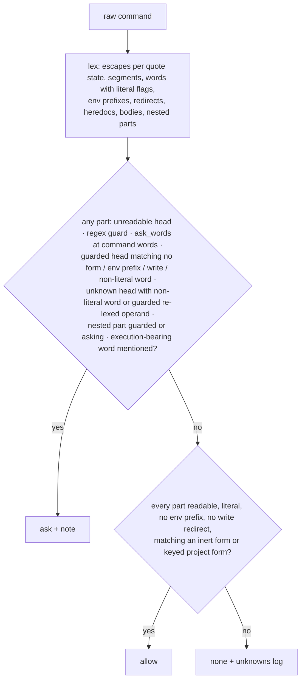

# Design: the Bash permission gate allows only read-only forms it fully models

- **Status:** proposed 2026-10-21 (task 019), **round 4** on 2026-10-22 after the arch-reviewer's
  third pass and the human's structural cut (inert = read-only); meant to be the last round
  before the build; not built
- **ADR:** [ADR-0015](../adr/0015-gate-allow-only-what-it-models.md) (proposed, revised in place)
- **Scope:** `.claude/scripts/bash_permission_gate.py`, `.claude/scripts/permission_recorder.py`,
  the seed `.claude/permissions-ledger.json`, their tests. `install.py` untouched; a report line
  for retired home regexes is a separate task.
- **Inputs:** the 2026-10-21 sweep report and corpus (session scratch `reports/018-sweep.md`,
  `sweep/`), the three arch-reviewer reports (`reports/019-arch-reviewer*.md`), the gate and
  recorder at commit `66dcf3b`, the seed ledger, ADR-0011, `install.py` `merge_ledger`
  (l.241-276, add-only), the `argparse` definitions of the `.claude/scripts/*.py` entry points
  and `install.py`.

## What and why

The gate is a PreToolUse hook on Bash. Its three answers mean: **allow** runs with no prompt and
skips auto mode's safety classifier; **ask** prompts the human; **none** lets the classifier
decide. Today it allows a command when every decomposed part starts with a ledger key, after
`shlex` has turned the words into strings; the shell expands first, so about sixty shapes read as
allowed commands that the shell turns into guarded ones, and more than twenty auto-allow on the
real seed ledger.

Three rounds of review showed that modelling what a CLI *writes* does not converge: every pass
found a new semantic (`TAR_OPTIONS`, `mypy --config-file` plugins, hard links, `mv` removing a
protected source, `tar host:` remote archives). The human cut the problem structurally: **an inert
form is read-only.** Nothing that writes, moves, links or removes a file is ever auto-allowed from
Bash; agents edit files with the Write and Edit tools, which `settings.json` governs. What runs
repo code or reads repo config is allowed only through an explicit **project form key**, and that
key is a stated act of trust in the repository's own code and config.

**Decisions this design builds to (the human's; not reopened):**

1. **Zero wrong allows.** Allow only a command the gate fully models.
2. **Ask when a guarded thing is involved, else none.** Not allowed plus git, gh, aws, docker,
   terraform, dropdb/psql, an interpreter or spawner, or a write to an execution-bearing path
   means ask; otherwise none.
3. **aws, terraform and gh api are allow-lists of read-only operations.**
4. **Guarded verbs match as the subcommand word only**; an unknown option in the resolving region
   asks.
5. **A closed allow-list (A)** carried by the gate; ledger keys select within it.
6. **A non-literal command name always asks (B).**
7. **Every current guard carries over (C).**
8. **The lexer is checked against the real shells (D).**
9. **Each tool has its own subcommand grammar (E).**
10. **Option-level allow-lists (G)**: tool + subcommand + exact options + positional roles.
11. **Secondary shell evaluation is re-lexed (H).** 12. **Indirect evaluation is unreadable (I).**
13. **Harness safety (K).**
14. **Inert = read-only (round 4).** (a) No Bash form that writes, moves, links or removes a file
    is inert; the write-resolution model is deleted; a Bash write gives none, or ask when an
    execution-bearing path is involved, by a cheap lexical test. (b) Any env-assignment prefix,
    `env`, `env --chdir`, `PATH=…` makes a part not inert; wrappers that change cwd or env are
    never peeled into an allow. (c) No option whose value is a path read as config, plugin, script
    or program is in any form; only flag/enum/int/literal-text shapes, plus input-file positionals
    for pure readers. (d) No network operands: no URLs, no `host:` archives, no `ext::`. (e)
    Project-code runners are explicit project form keys only, with the residual stated plainly.
    (f) `watch` and every spawner or wrapper involving a guarded tool asks, even when the nested
    form is inert.
15. Earlier answers stand: `git pull` only `--ff-only`/`--rebase`; `[ ]`/`[[ ]]`/`test` allow when
    all-literal, ask on a payload marker or `-v`, else none; non-literal arguments on inert
    read-only heads give none; `psql` always asks; `find -delete` asks; `--version`/`--help`
    forms and `gitleaks detect`/`protect` are in; no package installs; retired home regexes via a
    separate `install.py` report task.

**Done looks like:** every sweep row and every current guard test is a table row with one
verdict on the seed and on the seed plus broad grants; the differential test passes under `zsh`
and `/bin/bash` without ever reaching a real binary; the recorder cannot write a key outside the
table; the seed cannot name a form the table lacks; `ruff check . && mypy && pytest tests/unit`
and `pytest tests/integration` are green.

## Modules touched

| Path | Changes | Stays |
|---|---|---|
| `.claude/scripts/bash_permission_gate.py` | Lexer with escape state and literal flags; `_FORMS` (read-only inert forms and project forms, option-level); per-tool resolvers; `_SHELL_STRINGS`; the lexical execution-bearing test; three-valued `verdict`. Replaces `_segment_tokens` (shlex), `_split_segments`'s paren erasure, `_strip_heredocs`'s body drop, the `\\\n` pre-pass, `_SUB_TOKEN` as a head, the flat `ask_words_match`, `_tokens_allowed`'s prefix match; `evaluated_payload`'s rules move into the lexer and the builtin rule. No write resolution, no `realpath`/`isdir`. Public: `model_command(command) -> list[Part]`, `verdict(command, ledger) -> tuple[Literal["allow","ask","none"], str]`. | One module. `_config_dir`, `LEDGER_PATH`, `UNKNOWN_LOG`, `load_ledger`, `ledger_allow_keys`, ADR-0011's opaque refusal, `_EVALUATING_HEADS`, `_PAYLOAD_MARKERS`, the wrapper option tables (now used only to find the nested command), `ask_match`'s regex pass, `_decision`, `main`'s I/O and the unknowns log. |
| `.claude/scripts/permission_recorder.py` | `_grant_key` takes a `Part`; promotes only an inert form lacking a key whose verdict was none. | `PROMPTED_MODES`, `NEVER_PROMOTE`, `KEY_DEPTH`, `_plausible_command`, the atomic write, `example`. |
| `.claude/permissions-ledger.json` (seed) | Keys name full forms; every writer key (`mkdir`, `touch`, `cp`, `mv`, `tee`, `chmod`, `tar`, `zip`, `unzip`, `rmdir`, …) and every installer key gone; interpreter keys replaced by the project form keys listed below; aws exact read operations; terraform `ask_words` split; grammar-covered regexes leave; `_doc` restated. | Section shapes; every other regex; `grants`. |
| `tests/helpers/permission_cases.py` | `SWEEP_CASES`, `GUARD_REGRESSION_CASES` (with `intended_change`), `BROAD_GRANTS`, `BROAD_GRANTS_B`. | `HOOK_BYPASS_CASES`, `FEATURE_PUSH_CASES`. |
| `tests/helpers/argv_shim.py` (new) | Shim directory and eligibility filter for the differential test. | — |
| the four gate/recorder/ledger test files | Written by the tester seat to the plan. | Tier layout. |

`run_hook.py` unchanged. `install.py` unchanged: `merge_ledger` only adds, and a key cannot widen
the table.

## Data and flows

### The word model

One left-to-right pass with a quote state and an escape rule per state (unchanged from round 3):
outside quotes `\`+newline is deleted and `\x` is `x`; inside `"…"` a backslash escapes only `$`,
`` ` ``, `"`, `\`, newline and is otherwise kept (`"a\q"` is `a\q`); inside `'…'` nothing;
unquoted-delimiter heredoc bodies are live text with `\$`, `` \` ``, `\\`, `\`+newline escapes;
backtick bodies decode `\$`, `` \` ``, `\\`. Blanks are space, tab, newline — never `\r`.

**Word.** Literal when its runtime value is fixed by its text; non-literal when, outside single
quotes, it holds `$`, a backtick, `*`, `?`, `[`, a brace group with `,`/`..`, a leading `~` or
`=`, or `<(`/`>(`. **Segment**: words between unquoted `;`, `&&`, `||`, `|`, `|&`, `&`,
newline, with redirects and heredocs; leading `NAME=value` words are the **env prefix**.
**Substitution** bodies located and refused when opaque as today (ADR-0011 stands); a readable
body is its own part; `$(` inside `${…}` is extracted.

**Unreadable grammar (RC4, I).** Any unquoted paren outside the four modelled places (subshell
`(`, `$(`, `<(`/`>(`, `((`/`$((`); `${…}` holding `(`, `!`, `$(` or a backtick; an assignment
word whose name carries `[`; a standalone `((…))`; `declare -n`/`typeset -n`; any arithmetic
context (`$((…))`, `((…))`, `let`, `-eq`-family operands of `[`/`[[`/`test`, a subscript
`a[…]`) whose body is not a pure numeric expression (digits, `+ - * / % ** << >> & | ^ ~ ! < > =
? :`, parentheses, blanks).

**Part:** `head`, `words`, `env` (the prefix), `redirects` (every redirect, with its target
word), `heredocs`, `readable`, `nested: list[Part]` (the command a wrapper, spawner or
shell-string tool runs), `source`.

### Heads: the four kinds

1. **Unreadable** — always ask (B): a non-literal first word, an opaque body, an unreadable
   wrapper, unreadable grammar, a defining/evaluating builtin with a payload.
2. **Guarded** — `git`, `gh`, `aws`, `docker`, `terraform`, `dropdb`, `psql`; the
   **interpreters** `python*`, `node*`, `deno`, `bun`, `perl`, `ruby`, `php`, `lua`, `Rscript`,
   `tclsh`, `expect`, `osascript`, `pwsh`, `powershell`, **`awk`/`gawk`/`mawk`/`nawk`, `sed`/`gsed`**;
   the shells; the code-carrying builtins (`eval`, `source`, `.`, `trap`, `alias`, function
   definitions, `hash -p`, `enable -f`); every **wrapper**, **spawner** and **shell-string** tool
   (below); the repo-code runners (`make`, `npm`, `npx`, `pnpm`, `yarn`, `tox`, `pre-commit`,
   `pytest`, `ruff`, `mypy`, `uv`, `poetry`, `pipx`, `cargo`, `go`, `bundle`); `su`, `ssh`,
   `scp`, `rsync`. Allowed only through an inert form or a keyed project form; **any other form
   asks** (decision 2, class M) — `awk 'BEGIN{system("id")}'`, `sed e`, `xargs wc -l`, `watch
   'ls -la'`, `timeout 5 ls` all ask — as does any non-literal or unreadable word in the part.
3. **Inert** — a head in the read-only table. Allowed when the whole part matches one listed
   form and is keyed; otherwise none (a non-literal input operand, an unlisted option, `unzip
   a.zip`), except that an **execution option** on an inert tool makes the part a spawner part and
   asks: `find -exec`/`-execdir`/`-ok`/`-okdir`/`-delete`, `rg --pre`/`--pre-glob`, `sort
   --compress-program`, `tar --to-command`/`-I`/`--use-compress-program`/`--checkpoint-action`.
4. **Unknown** — a literal bare-name head in no table. Every operand is re-lexed (H): the
   operand sequence as an argv and each literal operand as a shell string; a re-lexed guarded,
   unreadable or asking part → ask. Otherwise all-literal → none; any non-literal or unreadable
   word → ask.

**Executable identity (class L).** Only a **bare name** can match a form: a head containing `/`
or starting with `.`, `~` or `=` (`./x`, `tools/cat`, `/usr/bin/cat`, `~/bin/git`,
`claude-temp/gate-venv/bin/python`) **never allows**. Its basename is re-lexed as a command word
to choose between ask and none (`/usr/local/bin/dropdb db` and `claude-temp/gate-venv/bin/python
-m mypy .` ask: a guarded basename; `tools/cat README.md` is none). And **any assignment word
anywhere in the command** — an env prefix, a bare `X=1` segment, `PATH=tools`, an `export`/
`declare`/`local`/`readonly`/`typeset`/`let`/`read`/`unset`/`mapfile` operand — means the command
cannot allow (`PATH=tools; cat README.md` is none, never allow); whether it asks or is none is
decided by the other rules (`V=merge; git $V x` asks).

**Defining and evaluating builtins (C).** `_EVALUATING_HEADS` carries over unchanged plus the
name-binding builtins; `eval`, `source`, `.`, `trap`, `alias`, function definitions, `hash -p`,
`enable -f` always ask; the others are unreadable with a payload or subscript in a dequoted
operand, or with a non-literal operand while a payload is in view; `-v` on `printf`, `test`, `[`,
`[[` asks in the builtin rule itself. `[`/`[[`/`test` with all-literal, payload-free operands and
no arithmetic comparison on an identifier are inert; with a non-literal operand and no payload in
view: none.

### Wrappers, spawners and shell strings (decision 14f, H)

`env`, `timeout`, `nohup`, `nice`, `command`, `time`, `exec`, `builtin`, `stdbuf`, `caffeinate`
(wrappers: argv known), `xargs`, `find -exec`/`-execdir`, `uv run`, `uvx`, `poetry run`,
`pipx run`, `npm exec`, `npx`, `pnpm exec`/`dlx`, `yarn exec`/`dlx`, `cargo run --`, `go run …
--`, `bundle exec`, `entr`, `parallel` (spawners: argv partly unknown — `{}` and stdin
non-literal), and `sh`/`bash`/`zsh`/`dash`/`ksh -c` or stdin, `su -c`, `ssh host …`, `watch`,
`script -c`, `osascript -e`, `expect -c`, `hyperfine`, `at`, `crontab`, `git -c alias.*=!…`,
`git config alias.*`, `git rebase --exec`, `git submodule foreach`, `git difftool -x`, `git bisect
run`, `gh alias set --shell`, `xargs … sh -c`, `find … -exec sh -c` (shell strings: the argument
is re-lexed as a command line) all produce a **nested part**. The rule is the same for all of
them (class M): the outer tool is guarded and has no allowable form, so the part **always asks**
— `timeout 5 git status`, `watch 'g\i\t status'`, `watch 'ls -la'`, `xargs wc -l`, `xargs git`,
`env X=1 cat f`, `find . -ok git status \;` all ask. The nested part is still lexed and judged
so that the reason names the inner guard (`merge stays human`) rather than the wrapper, and so
that a non-literal (`"git $1 x"`) or unparseable string is reported as unreadable. `command -v
<name>` is its own inert form (a query, not a wrapper); any other `command`, `builtin` or `exec`
use asks.

### Env prefixes and redirects (decision 14b)

A part with any env prefix (`X=1 cmd`, `PATH=… cmd`, `IFS=… cmd`) is **not inert**: ask when its
head is guarded (`GIT_EDITOR=x git commit`, `PYTHONPATH=. python3 -m pytest`), none otherwise
(`X=1 ls`). There is no steering-name table any more — every prefix is out. A bare assignment
segment (`X=1`, `V=merge`, `PATH=tools`) is **not scaffolding**: it is an assignment word, and
by class L the whole command cannot allow (none, or ask by the other rules). The inherited
environment and the home config files (`~/.gitconfig`, `~/.aws/config`, `~/.jq`,
`RIPGREP_CONFIG_PATH`) are trusted: the gate judges the command text.

Redirects: `2>&1`, `>&2`, `N>&M`, `>/dev/null`, `2>/dev/null`, `&>/dev/null` are inert; `<
<in-project literal path>` is an inert input; **every other redirect is a write** and makes the
part not inert — none, or ask by the lexical test below. Heredocs feeding an inert reader (`cat
<<'EOF'`) are inert data; feeding a guarded tool they are its stdin form (ask).

### The lexical execution-bearing test (decision 14a)

Applied only to a part that is **not allowed** (step 3 candidates), to choose ask or none: the
part asks when any literal word in it — redirect targets included — names an execution-bearing
path: a component `.git` or `.claude`; a basename in `{Makefile, GNUmakefile, makefile,
package.json, package-lock.json, pyproject.toml, setup.py, setup.cfg, conftest.py, tox.ini,
pytest.ini, .pre-commit-config.yaml, .npmrc, .envrc, Dockerfile, docker-compose.yml,
compose.yaml}`; a suffix `.sh`, `.bash`, `.zsh`; or a leading `~`, `$HOME`, `/etc/`, `/usr/`,
`/bin/`, `/sbin/`, `/Library/`, `/private/` (home dotfiles and system paths are ask-first by the
boundaries rule). No stat, no realpath, no destination semantics: the word only has to be
*mentioned* by a non-allowed part. `printf x > .git/hooks/pre-commit`, `cp a .claude/x`, `ln
.claude/permissions-ledger.json alias`, `mv .claude/settings.json saved.json`, `tee hooks/x` when
`hooks` is a symlink (the word `hooks/x` is not caught; but `tee` is not inert, so the part is
none and the classifier decides — a symlink the agent made earlier is the Write tool's business),
`echo x > ~/.zshrc` all ask or fall to none; none of them can be allow, which is the structural
point.

### The form table (A, G, 14c-e)

`_FORMS: dict[str, tuple[Form, ...]]`:

```
Form
  words:      tuple[str, ...]        # ("git", "status"), ("python3", "-m", "pytest")
  options:    dict[str, tuple[Shape, ...]]   # exact allowed options -> value shapes (() for a flag)
  positional: tuple[Role, ...]       # in order; a trailing "*" role repeats
  kind:       "inert" | "project"
```

**Shapes:** `int` (`^[0-9]+$`), `enum{a,b,…}`, `lit` (one literal word that does not start with
`-`), `name` (`^[A-Za-z0-9_.-]+$`), `ref` (`^[A-Za-z0-9_./@^~{}-]+$`, no leading `-`, no `:`),
and — **project forms only** — `path` (a literal relative path: no leading `/`, `~`, `=`, no `..`
component, no `:`). An option takes its values as the next words or, for a long option with one
value, as `--opt=value`; a short flag may sit in a cluster (`-la`); a cluster letter not listed
matches no form; a short option with a value takes it attached (`-n1`) or next, and must be last
in its cluster. **Roles:** `text*` (literal words; never interpreted as paths), `in*`/`in1`/`in?`
(input files: literal, relative or absolute under the project, no `..`, no `:`, no leading `~`),
`dir?` (an input directory, same rule), `name`, `ref*`, `lit`, `path` (project forms). **There is
no output role, no `out` shape, no URL/remote shape, no path-valued option** in any form. A
positional beyond the roles, an option not listed, a non-literal value: the part matches no
form.

**Inert forms** (read-only; stdout only; no repo config that can name a program is read —
implicit home config and the inherited environment are trusted):

| Tool | Options · positionals |
|---|---|
| `cd` | [`-P`, `-L`] · `dir?` or `-`; later parts' input paths are judged against the moved cwd, lexically |
| `pwd` [`-P`, `-L`] · `true` · `false` · `sleep` `int` · `echo` [`-n`, `-e`, `-E`] `text*` · `printf` format `lit`, `text*` · `seq` [`-s lit`, `-w`, `-f lit`] `int*` · `date` [`-u`, `-R`, `-I`, `-j`, `-d lit`] `text?` (`+format`) · `uname` [`-a`, `-s`, `-m`, `-r`, `-n`, `-p`, `-v`] · `hostname` · `whoami` · `id` [`-u`, `-g`, `-n`] · `basename` [`-a`, `-s lit`] `text*` · `dirname` `text*` · `realpath` [`-e`, `-m`, `-q`, `-s`] `in*` · `readlink` [`-f`, `-e`, `-m`, `-n`] `in*` · `which` [`-a`, `-s`] `name*` · `type` [`-a`, `-t`, `-p`, `-P`] `name*` · `command -v` `name` · `env` (bare: no options, no operands) |
| `ls` | [`-l`, `-a`, `-A`, `-h`, `-t`, `-r`, `-S`, `-R`, `-d`, `-1`, `-F`, `-G`, `-p`, `-i`, `-n`, `-s`, `-L`, `--color enum{never,always,auto}`] · `in*` |
| `cat` [`-n`, `-b`, `-s`, `-A`, `-e`, `-t`, `-v`, `-u`] `in*` · `head`, `tail` [`-n int`, `-c int`, `-q`, `-v`, `-f`, `-F`, `-r`] `in*` · `wc` [`-l`, `-w`, `-c`, `-m`, `-L`] `in*` · `sort` [`-n`, `-r`, `-u`, `-k lit`, `-t lit`, `-f`, `-b`, `-h`, `-V`, `-s`, `-z`, `-c`, `-i`, `-d`] `in*` · `uniq` [`-c`, `-d`, `-u`, `-i`, `-f int`, `-s int`, `-w int`] **`in?`** (a second positional is uniq's output: no form) · `cut` [`-d lit`, `-f lit`, `-c lit`, `-b lit`, `-s`, `--complement`, `--output-delimiter lit`] `in*` · `tr` [`-d`, `-s`, `-c`, `-C`] `lit lit?` · `diff` [`-u`, `-U int`, `-r`, `-q`, `-N`, `-w`, `-b`, `-B`, `-i`, `-p`, `-y`, `-a`, `-c`, `-x lit`, `--exclude lit`, `--brief`, `--color enum`, `--strip-trailing-cr`] `in1 in1` · `cmp` [`-l`, `-s`, `-n int`] `in1 in1` |
| `grep` | [`-r`, `-R`, `-n`, `-i`, `-l`, `-L`, `-c`, `-v`, `-w`, `-x`, `-E`, `-F`, `-P`, `-e lit`, `-A int`, `-B int`, `-C int`, `-o`, `-h`, `-H`, `-s`, `-q`, `-m int`, `-z`, `-a`, `-I`, `--null`, `--color enum`, `--include lit`, `--exclude lit`, `--exclude-dir lit`, `--`] · pattern `lit` (unless `-e`), `in*` (`-f` is a path option: not listed) |
| `rg` | [`-n`, `-i`, `-S`, `-l`, `-c`, `-v`, `-w`, `-x`, `-F`, `-e lit`, `-A int`, `-B int`, `-C int`, `-o`, `-g lit`, `-t lit`, `-T lit`, `--type-add lit`, `--files`, `--json`, `--hidden`, `--no-ignore`, `--max-count int`, `--sort lit`, `--color enum`, `-r lit`, `--no-messages`, `--no-config`, `--`] · pattern `lit`, `in*` (`--pre`, `--pre-glob`, `-f` not listed; `RIPGREP_CONFIG_PATH` is inherited env, trusted) |
| `file` [`-b`, `-i`, `--mime-type`, `--mime-encoding`, `-L`, `-h`] `in*` · `stat` [`-c lit`, `--format lit`, `-f lit`, `-L`, `-t`, `-x`] `in*` · `du` [`-h`, `-s`, `-a`, `-c`, `-d int`, `--max-depth int`, `-x`, `-k`, `-m`] `in*` · `df` [`-h`, `-k`, `-H`, `-i`, `-P`] `in*` · `ps` [`aux`, `-ef`, `-A`, `-e`, `-f`, `-x`, `-p lit`, `-o lit`, `-u lit`, `-ww`, `-c`] · `pgrep` [`-f`, `-l`, `-a`, `-u lit`, `-x`, `-n`, `-o`, `-d lit`] `lit` · `lsof` [`-i lit`, `-p lit`, `-n`, `-P`, `-t`, `-c lit`, `-u lit`, `-a`] `in*` · `base64` [`-d`, `-D`, `-w int`, `-b int`] `in*` · `shasum` [`-a int`, `-b`] `in*` (`-c` reads a path list: not listed) · `column` [`-t`, `-s lit`, `-c int`, `-x`] `in*` |
| `jq` | [`-r`, `-c`, `-e`, `-n`, `-s`, `-S`, `-j`, `-a`, `--tab`, `--indent int`, `--arg lit lit`, `--argjson lit lit`, `--raw-output`, `--compact-output`, `--slurp`, `--null-input`, `--exit-status`, `--sort-keys`] · filter `lit`, `in*` (`-f`, `--rawfile`, `--slurpfile`, `-L` are path options: not listed; `~/.jq` is a home file, trusted) |
| `find` | [`-L`, `-H`, `-P`, `-maxdepth int`, `-mindepth int`, `-depth`, `-prune`, `-name lit`, `-iname lit`, `-path lit`, `-ipath lit`, `-regex lit`, `-iregex lit`, `-type lit`, `-size lit`, `-empty`, `-mtime lit`, `-mmin lit`, `-perm lit`, `-user lit`, `-group lit`, `-links int`, `-print`, `-print0`, `-ls`, `-not`, `!`, `-a`, `-o`, `(`, `)` quoted] · `dir?*` then the expression. `-exec`/`-execdir` are the spawner form; `-ok`, `-okdir`, `-delete`, `-fprint`, `-fprintf`, `-fls`, `-newer` (path) are not listed |
| `sed`, `gsed` | [`-n`, `-E`, `-r`, `-s`, `-u`, `-z`, `-e lit`, `--expression lit`, `--sandbox`] · script `lit` (unless `-e`), `in*`; every script word must match `_SED_SAFE_SCRIPT` (addresses `N`, `$`, `/re/`, `N,M`, `N~M`, `addr!`; commands `s<d>…<d>…<d>[gIimp0-9]*`, `y<d>…<d>…<d>`, `d`, `p`, `=`, `q`, `Q`, `n`, `N`, `D`, `P`, `h`, `H`, `g`, `G`, `x`, `l`, `a\ text`, `i\ text`, `c\ text`, joined by `;`/newline; nothing else — so `e`, `w`, `W`, `r`, `R`, `{}` and the `w`/`e` flags never appear). **`-i` is a write and is not listed**; `-f` is a path option |
| `awk`, `gawk`, `mawk`, `nawk` | [`-F lit`, `-v lit`, `--`] · program `lit`, then `in*` or `name=value` literal operands; the program must hold none of `system`, `getline`, `\|`, `>`, `@` (awk's complete command and file exits; awk has no `eval`). `-f`, `-e`, `--source`, `-l`, `-i`, `-E`, `--exec`, `-M` not listed |
| `tar` | the form is `tar -tf` (words `tar`, `-tf`; clusters `-tzf`, `-tjf`, `-tJf`, `-tvf` accepted as the same form) [`-v`] · `in1` — the archive is an input positional, so by the `in` rule it holds no `:` and `host:archive` matches no form. **`tar -c`/`-x`/`-r`/`-u` are writes: not listed.** `TAR_OPTIONS` in a prefix is an env prefix (not inert); inherited, trusted |
| `unzip` | four forms whose **mode is part of the words**: `unzip -l`, `unzip -t`, `unzip -p`, `unzip -Z` [`-q`] · `in1`. Bare `unzip a.zip` and `unzip -q a.zip` match no form (extraction is the default action and a write). Every other reader in this table prints to stdout by default; `tar` (`-tf` in the words), `unzip` and `terraform fmt -check` are the three whose read mode must be named in the form |
| `test`, `[`, `[[` | all-literal, payload-free operands; `-v` asks |
| `gitleaks` | `gitleaks detect` / `gitleaks protect` [`--staged`, `--no-banner`, `-v`, `--verbose`, `--redact`, `--exit-code int`, `--no-git`] · none; `gitleaks version` (`--source`, `--config`, `--report-path`, `--log-opts` are path or pass-through options: not listed; `.gitleaks.toml` is a repo config of allow-lists, not programs) |
| `aws` | exact read operations with global options [`--profile lit`, `--region lit`, `--output enum{json,text,table,yaml}`, `--query lit`, `--no-cli-pager`, `--no-paginate`, `--cli-read-timeout int`, `--cli-connect-timeout int`, `--no-verify-ssl`, `--debug`, `--color enum`] and the operation's parameters as listed; **no positional operand at all** (so `s3 ls` lists buckets only; `s3api list-objects-v2 --bucket lit --prefix lit` lists keys). Seed: `sts get-caller-identity`; `s3 ls`; `s3api list-buckets`; `s3api list-objects-v2` [`--bucket lit`, `--prefix lit`, `--delimiter lit`, `--max-items int`, `--page-size int`, `--starting-token lit`]; `s3api head-object` [`--bucket lit`, `--key lit`]; `ec2 describe-instances` [`--instance-ids lit*`, `--filters lit*`, `--max-items int`, `--page-size int`, `--starting-token lit`]; `ec2 describe-security-groups` [`--group-ids lit*`, `--filters lit*`, …]; `ec2 describe-vpcs` [`--vpc-ids lit*`, `--filters lit*`]; `ec2 describe-subnets` [`--subnet-ids lit*`, `--filters lit*`]; `iam get-user` [`--user-name lit`]; `iam list-roles` [`--path-prefix lit`, `--max-items int`]; `lambda list-functions` [`--max-items int`]; `logs describe-log-groups` [`--log-group-name-prefix lit`, `--max-items int`]; `logs filter-log-events` [`--log-group-name lit`, `--log-stream-names lit*`, `--filter-pattern lit`, `--start-time int`, `--end-time int`, `--limit int`, `--max-items int`]; `cloudformation describe-stacks` [`--stack-name lit`]; `cloudformation describe-stack-events` [`--stack-name lit`, `--max-items int`]; `ecs list-clusters`; `ecs list-services` [`--cluster lit`]; `ecs describe-services` [`--cluster lit`, `--services lit*`]; `rds describe-db-instances` [`--db-instance-identifier lit`]. `--cli-input-json`/`--cli-input-yaml` (path), `logs tail` (positional), `s3api get-object`, `lambda invoke`, `ssm get-parameter`, `secretsmanager get-secret-value` are not listed; every other operation asks (decision 3). `~/.aws/config` `credential_process` is a home file, trusted |
| `docker` | `docker ps` [`-a`, `-q`, `--format lit`, `--filter lit`, `-n int`, `-l`, `-s`], `docker images` [`-a`, `-q`, `--format lit`, `--filter lit`, `--digests`], `docker logs` [`-f`, `--tail int`, `--since lit`, `--until lit`, `-t`, `-n int`] `name`, `docker info`, `docker version`, `docker inspect` [`--format lit`, `--type lit`] `name*`. Global options: none listed (`--context`, `-H`, `--config` change the target). `docker compose *`, `docker build` are not forms: they read `compose.yaml`/`Dockerfile` and run containers, and no form for them exists in this design |
| `terraform` | `terraform fmt -check` [`-diff`, `-recursive`, `-no-color`] `dir?`, `terraform version` [`-json`]. Everything that loads providers (`validate`, `output`, `show`, `state`, `workspace`, `providers`, `graph`, `init`, `plan`) runs provider binaries from `.terraform/` and is not a form; `apply`, `destroy`, `import`, … keep their guards. All of them ask |
| every tool in either table | `<tool> --version`, `-V`/`-v` where that is the version flag, `--help`, `-h` · none (`gh --version`, `git --version`, `python3 --version`, `codex --version`, `claude --version`, …) |

Not in the inert table and never allowed: `mkdir`, `rmdir`, `touch`, `chmod`, `cp`, `mv`, `ln`,
`tee`, `zip`, `tar -c/-x`, `sed -i`, `sort -o`, every redirect to a file, every installer, `rm`,
`curl`, `wget`, `ssh`, `scp`, `rsync`, `dropdb`, `psql`, `sudo`, `open`. A Bash write is none
(or ask by the lexical test); the Write and Edit tools are how an agent changes a file.

**Project forms** (run repo code, read repo config that can name a program, or mutate the repo
or its remote; allowed only through an explicit full-form key in the ledger; `path` shape
permitted). **A project form key is a stated act of trust in the repository's own code and
config**: `pytest` runs `conftest.py` and whatever the tests import; `mypy` and `ruff check`
read `pyproject.toml` (mypy loads the plugins it names); every `git` form reads `.git/config`,
`.gitattributes` and `.git/hooks`, any of which can name a program (`core.fsmonitor`,
`diff.external`, `filter.*`, `pre-commit`); `gh` runs `git` to resolve the repository; the
`.claude/scripts` CLIs are this project's own code, and `codex_seat.py`/`debate.py` run the Codex
CLI; `git_checkpoint.py` commits and pushes a feature branch; tool caches (`.pytest_cache`,
`.mypy_cache`, `.ruff_cache`, `__pycache__`) and git's own object store are the writes these
forms make. A file written in an earlier Bash call or by the Write/Edit tools and picked up by
one of these forms is therefore not seen, and that is accepted by the key.

| Project form (exact key) | Options · positionals |
|---|---|
| `pytest`, `python3 -m pytest`, `python -m pytest` | [`-q`, `-v`, `-vv`, `-x`, `-s`, `-k lit`, `-m lit`, `--tb lit`, `--maxfail int`, `--lf`, `--ff`, `--co`, `--collect-only`, `--durations int`, `-r lit`, `--no-header`, `--disable-warnings`, `-W lit`, `--ignore lit`, `--deselect lit`, `--log-level lit`, `-p no:*` (the `no:` prefix only)] · `path*` (`-p <plugin>`, `-o`, `--override-ini`, `-c`, `--rootdir`, `--basetemp`, `--junitxml`, `--pdb`, `--pdbcls` not listed) |
| `mypy`, `python3 -m mypy`, `python -m mypy` | [`--strict`, `--ignore-missing-imports`, `--no-error-summary`, `--show-error-codes`, `--pretty`, `--follow-imports lit`, `--python-version lit`, `--warn-unused-ignores`, `--no-incremental`, `--explicit-package-bases`, `--namespace-packages`] · `path*` (bare `mypy` reads `pyproject.toml`'s `files`; `--config-file`, `--install-types`, `--python-executable`, `--cache-dir`, `*-report`, `-c` not listed) |
| `ruff check`, `python3 -m ruff check` | [`--select lit`, `--ignore lit`, `--extend-select lit`, `--line-length int`, `--output-format lit`, `--statistics`, `--no-cache`, `-q`, `--quiet`, `--exit-zero`, `--show-fixes`, `--diff`, `--isolated`] · `path*` (`--fix` writes, `--config`, `-o` not listed; `ruff format` is a write and is not seeded) |
| `python3 install.py` | [`--status`, `--dry-run`] — exactly one of them required · none (bare, `--uninstall`, `--home`, `--python` write the home config: not forms) |
| `python3 .claude/scripts/codex_seat.py` | `enum{tester,reviewer,arch-reviewer}` · [`--brief path`, `--out path`, `--stack lit`*, `--timeout int`, `--dry-run`] |
| `python3 .claude/scripts/debate.py` | `enum{researcher,architect}` · [`--brief path`, `--out path`, `--seat lit`*, `--judge lit`, `--max-calls int`, `--timeout int`, `--no-critique`, `--dry-run`] |
| `python3 .claude/scripts/model_route.py` | [`--agent lit`, `--brief path`, `--explain`] (stdin via `< path` allowed) |
| `python3 .claude/scripts/git_checkpoint.py` | [`--message-file path`, `--no-push`] · `lit?` (message) |
| `python3 .claude/scripts/new_task.py` | [`--title-file path`] · `lit?` (title) (`--tasks-dir` not listed) |
| `python3 .claude/scripts/bash_permission_gate.py` | none · none (stdin JSON; appends the unknowns log — its own write) |
| `git status` | [`-s`, `--short`, `-b`, `--branch`, `--porcelain`, `--porcelain=v2`, `-u lit`, `--untracked-files lit`, `--ignored`, `-z`, `--no-ahead-behind`] · `path*` |
| `git log`, `git show`, `git diff` | [`--oneline`, `--graph`, `--decorate`, `--stat`, `--name-only`, `--name-status`, `-p`, `-U int`, `-n int`, `--max-count int`, `--since lit`, `--until lit`, `--author lit`, `--grep lit`, `-S lit`, `-G lit`, `--all`, `--first-parent`, `--no-merges`, `--merges`, `--pretty lit`, `--format lit`, `--date lit`, `--abbrev-commit`, `--reverse`, `--cached`, `--staged`, `-w`, `-b`, `--color lit`, `--no-color`, `--word-diff`, `-M`, `-C`, `--find-renames`, `--diff-filter lit`, `--numstat`, `--shortstat`, `--summary`, `--quiet`, `--exit-code`, `--no-prefix`, `--relative`, `-z`, `--`] · `ref*`, `path*` (`--output`, `--ext-diff`, `--textconv`, `-O`, `--open-files-in-pager` not listed) |
| `git rev-parse` [`--show-toplevel`, `--abbrev-ref`, `--verify`, `--short`, `--git-dir`, `--is-inside-work-tree`, `--symbolic-full-name`] `ref*` · `git rev-list` [`--count`, `-n int`, `--max-count int`, `--all`, `--reverse`] `ref*` · `git merge-base` [`--is-ancestor`] `ref ref` · `git describe` [`--tags`, `--always`, `--abbrev int`, `--dirty`] `ref?` · `git ls-files` [`-z`, `-c`, `-o`, `-m`, `-d`, `--exclude-standard`, `--error-unmatch`] `path*` · `git ls-tree` [`-r`, `-z`, `--name-only`] `ref path*` · `git cat-file` [`-t`, `-p`, `-s`, `-e`] `ref` · `git blame` [`-L lit`, `-w`, `-s`, `--porcelain`] `path` · `git shortlog` [`-s`, `-n`, `-e`] `ref*` · `git reflog` [`show`, `-n int`] `ref?` · `git check-ignore` [`-q`, `-v`] `path*` · `git count-objects` [`-v`] · `git grep` [`-n`, `-i`, `-l`, `-c`, `-w`, `-E`, `-F`, `-e lit`, `--cached`, `--`] `lit ref? path*` · `git remote` [`-v`], `git remote show name`, `git remote get-url name` [`--push`, `--all`] · `git config --get lit`, `git config --get-all lit`, `git config --get-regexp lit`, `git config -l`/`--list` [`--show-origin`, `--show-scope`, `--global`, `--local`] · `git stash list` [`-p`], `git stash show` [`-p`, `--stat`] `lit?` · `git worktree list` [`--porcelain`] · `git tag -l`/`--list` [`-n int`, `--sort lit`, `--contains ref`] `lit?` · `git ls-remote` [`--heads`, `--tags`, `-q`] `name? ref*` |
| `git add` | [`-A`, `--all`, `-u`, `-N`, `--intent-to-add`, `-f`, `-v`, `-n`, `--dry-run`, `--`] · `path*` (`-p`, `-i`, `-e` not listed) |
| `git commit` | [`-m lit`, `--message lit`, `-a`, `--all`, `--amend`, `--no-edit`, `--allow-empty`, `--allow-empty-message`, `-q`, `--date lit`, `--author lit`, `-F path`, `--file path`, `--`] · `path*` (`-e`, `--edit`, `-p`, `-i`, `-S`, `--gpg-sign`, `-t`, `--template`, `-c`/`-C`, `--no-verify` (regex guard) not listed) |
| `git switch` [`-c ref`, `--create ref`, `--detach`, `-q`, `-t`, `--track`] `ref?` · `git checkout` [`-b ref`, `-q`, `--detach`, `-t`, `--track`, `--`] `ref? path*` · `git restore` [`-S`, `--staged`, `-W`, `--worktree`, `-s ref`, `--source ref`, `-q`, `--`] `path*` · `git branch` [`-a`, `-r`, `-v`, `-vv`, `-l`, `--list`, `--show-current`, `--contains ref`, `--merged ref`, `--no-merged ref`, `-d ref`, `--delete ref`, `-m ref ref`, `-u ref`, `--set-upstream-to ref`, `--unset-upstream`, `--format lit`, `--sort lit`] `ref*` (`-D`, `-M`, `--edit-description` not listed) · `git tag` [`-a`, `-m lit`, `-d ref`] `ref? ref?` (`-s`, `-u`, `-e`, `-F` not listed) |
| `git fetch` [`--prune`, `-p`, `--tags`, `-t`, `--depth int`, `-q`, `--all`, `--no-tags`, `--dry-run`] `name? ref*` · `git pull` **requires `--ff-only` or `--rebase`** [`-q`, `--no-tags`, `--depth int`, `--prune`] `name? ref?` · `git push` [`-u`, `--set-upstream`, `-q`, `--tags`, `--dry-run`, `-n`] `name ref` where `ref` matches `^(feat|fix|feature|docs|chore|refactor|test)/` (the `allow_patterns` regex selects it; the shared-branch and force regexes keep asking; `-f`, `--force*`, `-d`, `--delete`, `--all`, `--mirror`, `--receive-pack`, `--exec`, `-o`, `--no-verify` not listed) · `git stash push` [`-m lit`, `-u`, `-k`, `--`] `path*`, `git stash pop`/`apply` `lit?` · `git rebase` [`--onto ref`, `-q`, `--autostash`, `--continue`, `--abort`, `--skip`, `--quit`] `ref*` (`-i`, `-x`, `--exec`, `-s`, `-X`, `--autosquash`, `--edit-todo` not listed) · `git reset` [`--soft`, `--mixed`, `-q`, `--`] `ref? path*` (`--hard` regex guard; `--merge`, `--keep`, `-p` not listed) · `git rm` [`--cached`, `-r`, `-q`, `-n`, `--`] `path*` · `git worktree add` [`-b ref`, `--detach`] `path ref?`, `git worktree prune`, `git worktree remove` `path` (no `--force`) · `git init` [`-q`, `-b ref`, `--initial-branch ref`] · none |
| git global options | none are listed: `-C`, `-c`, `--git-dir`, `--work-tree`, `--exec-path`, `--config-env`, `--namespace`, `--attr-source`, `-p`, `-P`, `--no-pager` all make a git part match no form (git is guarded: ask). `--no-pager` is not needed: hooks run without a tty |
| `gh pr list` [`-s lit`, `--state lit`, `-L int`, `--limit int`, `--search lit`, `-A lit`, `--author lit`, `-B lit`, `--base lit`, `-H lit`, `--head lit`, `-l lit`, `--label lit`, `--json lit`, `-q lit`, `--jq lit`, `-t lit`, `--template lit`] · `gh pr view` [`--json lit`, `-q lit`, `--jq lit`, `-c`, `--comments`] `lit?` · `gh pr status` · `gh pr checks` [`--watch`] `lit?` · `gh pr diff` [`--patch`, `--color lit`, `--name-only`] `lit?` · `gh pr create` [`-t lit`, `--title lit`, `-b lit`, `--body lit`, `-F path`, `--body-file path`, `-B lit`, `--base lit`, `-H lit`, `--head lit`, `-d`, `--draft`, `-l lit`, `--label lit`, `-r lit`, `--reviewer lit`, `-a lit`, `--assignee lit`, `-f`, `--fill`] · `gh pr edit` [`-t lit`, `-b lit`, `-F path`, `--add-label lit`, `--remove-label lit`, `--add-reviewer lit`] `lit?` · `gh pr comment` [`-b lit`, `-F path`] `lit?` · `gh pr review` [`-a`, `--approve`, `-c`, `--comment`, `-r`, `--request-changes`, `-b lit`, `-F path`] `lit?` · `gh pr ready`, `gh pr close` [`-c lit`], `gh pr reopen` `lit?` · `gh pr checkout` [`-b lit`] `lit` · `gh issue list/view/create/edit/comment/close/reopen` with the same shapes · `gh run list` [`-L int`, `-w lit`, `-b lit`, `--json lit`, `-q lit`] · `gh run view` [`--log`, `--log-failed`, `-j lit`, `--json lit`, `-q lit`] `lit?` · `gh run watch` [`--exit-status`, `-i int`] `lit?` · `gh run rerun` [`--failed`] `lit?` · `gh repo view` [`--json lit`, `-q lit`, `-b lit`] `lit?` · `gh auth status` · `gh api` [`-H lit`, `--header lit`, `-q lit`, `--jq lit`, `-t lit`, `--template lit`, `--hostname lit`, `--cache lit`, `-p`, `--preview lit`, `--paginate`, `--slurp`, `--silent`, `-i`, `--include`, `--verbose`, `-X GET`, `--method GET`, `--method=GET`, `-XGET`] · endpoint `^[A-Za-z0-9_./{}-]+$` (no `://`, no `:`). Global [`-R lit`, `--repo lit`, `--hostname lit`]. **Not forms:** every `--web`/`-w`, `-e`/`--editor`, `gh auth token`, `gh repo clone`, `run download`, `release download`, `gh alias`, `gh extension`, `gh config set`, `secret`/`variable set`/`delete`, `pr merge`, `repo delete`/`rename`, `api` with `-f`, `-F`, `--field`, `--raw-field`, `--input` or a non-GET method |

**There are no other forms (class P).** `make`, `npm run`, `npx`, `tox`, `pre-commit`, `go`,
`cargo`, `docker build`, `docker compose`, `terraform init`/`plan`/`validate`/…, `<shell>
<path>`, `<interpreter> <path>`, `node <path>` have **no form in this design**: they are guarded
tools and ask. A later project that needs one adds the form to the gate's table and the key to
the seed in one reviewed change; nothing in the table is defined-but-unkeyed, so no old home key
can select a form the seed did not mean.

**Whole-tool keys.** A key naming a tool selects every inert form of that tool; it selects no
project form. The seed's `allow_keys` are exactly: every inert tool above by name, `aws
<service> <operation>` per listed operation, and the project form keys listed in the table
above (`pytest`, `python3 -m pytest`, `python -m pytest`, `mypy`, `python3 -m mypy`, `python -m
mypy`, `ruff check`, `python3 -m ruff check`, `python3 install.py`, the six
`python3 .claude/scripts/*.py` forms, `gitleaks` (inert), and each `git <subcommand>` and
`gh <noun> <verb>` named above). A migrated home that still holds `python3`, `mkdir`, `tee`,
`cp`, `tar`, `terraform plan` or `docker build` keeps them; they select nothing, because no form
exists for them — a migrated home is therefore never wider than the seed.

### Per-tool subcommand grammar (E)

Unchanged from round 3: a resolver per guarded tool finds the command words (git: the
subcommand, with `remote`, `stash`, `worktree`, `config`, `bisect`, `submodule`, `notes` taking
a verb — and, now, **any global option before the subcommand** makes the part match no form; gh:
nouns vs the single-word `api`/`browse`/`status`/`completion`, with only `-R`/`--repo`/`--hostname`
allowed before the noun; aws: known globals anywhere, `<service> <operation>`; docker: management
commands vs verbs, so `docker logs push` is `logs` on container `push`; terraform: `state`,
`workspace`, `providers` take a verb). `ask_words` groups match command words only.

### The verdict

```
verdict(command, ledger) -> ("allow" | "ask" | "none", reason)

  parts = model_command(command)        # segments, bodies, heredoc bodies, nested parts
  1. ask when any part (nested included):
       - has an unreadable head                                               [B, C, I]
       - trips a regex ask_pattern or denial (raw text or normalized part)    [carried over]
       - trips an ask_words rule at its command words                         [decision 4]
       - has a guarded head — a guarded tool, an interpreter (awk and sed
         included), a shell, a code-carrying builtin, a wrapper, a spawner, a
         shell-string tool, a repo-code runner — and does not match an inert or
         keyed project form; a wrapper/spawner/shell-string part never does    [decision 2, M]
       - has an inert head with an execution option (find -exec/-ok/-delete,
         rg --pre, sort --compress-program, tar --to-command/-I)              [M]
       - has a path head whose basename is guarded                            [L]
       - has an unknown head with a non-literal/unreadable word, or whose
         re-lexed operands contain a guarded/unreadable/asking part           [H]
       - is not allowed and mentions an execution-bearing word                [14a, lexical]
  2. allow when every part is readable, every word literal, no assignment word exists
     anywhere in the command, no part has a path head, an env prefix or a write
     redirect, and every part with a head matches an inert form or a keyed project
     form selected by allow_keys / grants / allow_patterns (the numeric builtins
     exit/break/continue/return/shift/set are scaffolding; `cd dir` moves the lexical
     cwd)                                                                     [L]
  3. otherwise none + the unknowns log
     — reached only by: an inert head whose part matches no form (unlisted option,
       non-literal operand, `unzip a.zip`, a write redirect); an unknown bare-name head
       with literal words and no guarded re-lexed operand; a path head with an
       unguarded basename; an assignment-only command; a non-guarded part with an
       env prefix (`X=1 ls`)
```



### What each sweep row becomes

`SWEEP_CASES` rows carry `(label, command, expected_R, expected_A, expected_B, shells,
eligible)`, one verdict per ledger. Derivation: step 1 asks; step 2 allows; else none.

- **cases1:** every row asks except `baseline-allowed` (`git status`, allow — a keyed project
  form). `time`, `timeout`, `nice`, `nohup`, `env`, `command`, `stdbuf`, `watch`, `script`
  rows ask as wrappers over a guarded tool.
- **cases2:** every row asks (`make-plain` and `npm-run` are unkeyed repo-code runners: guarded,
  ask; `git-pull` plain asks; `python-c`, `node-e`, `perl-e`, `awk`/`sed-e` rows ask).
- **cases3:** every row asks (`git-hook-tee` and `git-hook`: `tee`/redirect into `.git/` is the
  lexical test; `tf-plan-out`: `apply`; `aws-*`: unlisted operations; `docker-*`: guarded
  verbs or unlisted options; `script-file`, `tee-script`, `makefile-write`, `pkgjson-npm`:
  shells, execution-bearing words, `npm pkg set`).
- **cases4:** every row asks.
- **cases5:** every row asks.
- **cases6:** `fp-log-grep`, `fp-commit-m`, `fp-path`, `fp-gh-search`, `fp-aws-filter`,
  `fp-git-diff-merge-word` allow; `fp-tf-state-list` and `fp-docker-compose-push-name` **ask
  on every ledger** — `terraform state list` and `docker compose logs` have no form, and
  terraform and docker are guarded; they stop being false prompts only when a later reviewed
  change adds those forms; `fp-arith` asks (substitution in arithmetic); `fp-sub-quote` asks
  (opaque body).
- `HOOK_BYPASS_CASES`, `FEATURE_PUSH_CASES`: unchanged verdicts.
- **`GUARD_REGRESSION_CASES`** — every case the current unit and integration tests encode, with
  its current verdict unless marked `intended_change="<reason>"`: `git -C merge status` (ask →
  **ask**, now for a different reason: `-C` is not a listed global option — not an intended
  change after all; the test's row stays `ask`); `echo $((1+2))` (allow → none: non-literal
  argument); `echo "$(git rev-parse HEAD)"` (allow → none); `echo $(git rev-parse HEAD)` (allow →
  none); `env command git commit …` rows (ask stays ask); `MODE=test /usr/bin/git commit …`
  (ask stays ask); current none rows that become ask under B/C/I/14f (`G=git; $G merge x`,
  `echo $(gi''t merge y)`, `x='…'; echo $((x))`, `timeout 5 git status`). A row not so marked
  must keep its verdict.
- **One value per row:** `python3 -m pip install x` is **ask** on R, A and B alike (a guarded
  interpreter matching no form); round 3's "none" is withdrawn.

Ledger A = seed + whole-tool keys for `git`, `gh`, `aws`, `docker`, `terraform`, `dropdb`,
`python3`, `node`, `xargs`, `printf`, `find`, `make`, `npm`, `env`, `timeout`, `uv`, `let`,
`gawk`, `tar`, `uniq`, `mkdir`, `tee`, `cp`, `mv`, `ln`; ledger B = A + `sh`, `bash`, `zsh`,
`eval`, `perl`, `awk`, `sed`, `python3 -c`, `python3 -m pip`, `mypy --config-file`. On A and B
every row's verdict equals its verdict on R except where the only difference was a missing key
for an **inert** form or a seeded project form (`git rebase master` allows on A; `make deploy`
stays ask on A because no `make` form exists). `TAR_OPTIONS=… tar -tf a.tar` (none: an
assignment word defeats allow and `tar` is not guarded), `env --chdir=/x tee r` (ask: `env` is a
wrapper), `mypy --config-file c.ini` (ask: a guarded runner with an unlisted option), `ln
.claude/… alias` and `mv .claude/settings.json s.json` (ask: the lexical test), `tar -cf
host:a.tar x` (none: `tar -c` matches no form, tar is not guarded, nothing execution-bearing is
mentioned — the classifier decides), `watch 'g\i\t status'` and `watch 'ls -la'` and `xargs wc
-l` (ask: wrappers), `awk 'BEGIN{system("id")}'`, `sed e`, `find . -ok git status \;` (ask: an
interpreter outside its form, an execution option), `PATH=/usr/bin git clean -fdx` (ask),
`PATH=tools; cat README.md` and `tools/cat README.md` and `./x` (none: an assignment word or a
path head, nothing guarded), `/usr/local/bin/dropdb db` and `claude-temp/gate-venv/bin/python -m
mypy .` (ask: a guarded basename), `unzip a.zip` (none) — none of them can be allow on any
ledger.

### Ledger schema and migration

No new sections; shapes unchanged. `allow_keys` are full form names; a key outside the table
selects nothing, and `test_ledger_guards.py` fails the seed if it names a form the table lacks or
any writer or installer. `ask_words` match command words; `allow_patterns` select the
feature-branch `git push` form; regex guards unchanged. Seed changes: every writer key and
whole-tool interpreter key removed; the project form keys above added; aws exact operations
added; terraform `ask_words` split (`[[apply, destroy, import, taint, untaint, force-unlock,
console, test]]`, `[[state],[rm, mv, push, pull, replace-provider]]`, `[[workspace],[delete,
new, select]]`); the aws, docker and terraform regexes the grammar covers leave; every other
regex stays. A home ledger keeps everything it has; a retained key cannot widen the table.

### The recorder

Promotes only when the verdict was none, and only an **inert form** lacking a key; the key is the
form's words to `KEY_DEPTH`. Project forms, unknown tools, writers, guarded verdicts and
non-literal parts are not promotable; one non-promotable part blocks the whole promotion.
`NEVER_PROMOTE`, `git push`, `_plausible_command` stay. `/permit --allow "<form>"` adds a project
form by hand.

## Boundaries

- **Writes:** the gate appends to `permission-unknowns.log`; the recorder rewrites the ledger
  atomically. The gate does **no** filesystem lookups: no `stat`, `realpath` or `isdir`.
- **Calls:** none; stdlib only.
- **Must not reach:** the home ledger from tests; the network; any real binary from the
  differential test.
- **Permissions:** none new.

## Test plan by tier

- **Unit — `pytest tests/unit/scripts/test_bash_permission_gate.py`** (no I/O; `permission_gate`
  fixture). Proves: the escape rules per quote state; `\r` not a blank; literal flags per word
  shape; the four heads; path heads never allow and a guarded basename asks (`tools/cat`,
  `./x`, `/usr/local/bin/dropdb`, `claude-temp/gate-venv/bin/python`); any assignment word
  anywhere defeats allow (`PATH=tools; cat f`, `export X=1; cat f`, `X=1 ls`); class-C builtin
  rules incl. `-v` on all four; class-I arithmetic rules; the four `(` positions; heredoc bodies
  as parts; env prefixes and write redirects defeat allow; the lexical execution-bearing test
  (`.git/`, `.claude/`, `Makefile`, `*.sh`, `~/`, `/etc/`); **every form in the table** — a
  positive case per form and a negative case per excluded option named in the table (`tar
  -cf`, `unzip a.zip`, `uniq a b`, `git diff --output`, `sort -o`, `grep -f`, `jq --rawfile`,
  `mypy --config-file`, `pytest -p x`, `gh pr view --web`, `git -C x status`, `aws s3 ls
  s3://b`); the resolver per tool; every wrapper, spawner and shell-string tool asks even over
  an inert nested form (`xargs wc -l`, `watch 'ls -la'`), and an interpreter outside its form
  asks (`awk 'BEGIN{system("id")}'`, `sed e`); execution options on inert tools (`find -ok`,
  `find -delete`, `rg --pre`); and the tables `SWEEP_CASES`, `GUARD_REGRESSION_CASES`,
  `HOOK_BYPASS_CASES`/`FEATURE_PUSH_CASES` through `verdict` on ledgers R, A and B.
- **Unit — `pytest tests/unit/scripts/test_ledger_guards.py`**: the seed's decisions; every seed
  `allow_keys` entry names a form in the table; no writer, installer or whole-tool interpreter
  key is present.
- **Unit — `pytest tests/unit/scripts/test_permission_recorder.py`**: no grant for ask/allow,
  project forms, unknown tools, writers, non-literal parts; `wc -l f` on a ledger lacking `wc`
  records `wc`; opaque records nothing.
- **Unit — `pytest tests/unit/test_install.py`**: `merge_ledger` add-only, unchanged.
- **Integration — `pytest tests/integration/scripts/test_bash_permission_gate.py`**:
  1. the hook as a subprocess over all tables (exit 0, empty stderr, JSON verdict).
  2. **Differential (D, K)**, `test_gate_word_view_matches_shell_argv`. **Eligibility** (decided
     from the gate's own lexing before anything runs): the row has no assignment word anywhere
     (no env prefix, no `X=…` segment, no `PATH=`), no `env`, `command`, `builtin`, `exec`, `hash`
     or `enable` word in any position (`command -p` searches a default path and reaches the real
     `/usr/bin/git`), no head containing `/`, `~` or `=`, no unreadable head, and every head of
     every part (nested included) is either a shell builtin or a name in the shim set; any other
     row is **parse-only** (hook verdict asserted, nothing executed). The shim set
     is every external program named anywhere in the corpus (`git gh aws docker terraform dropdb
     psql make npm npx uv node perl python3 sed awk xargs find parallel tee cp mv ln cat ls sh
     bash zsh stdbuf watch script su ssh tar uniq sort wc grep mypy ruff pytest`); each shim
     appends `argv0\0argv…\0\n` to `$ARGV_LOG` and exits 0. The row runs as
     `subprocess.run([shell, "-c", row], env={"PATH": shimdir, "HOME": home, "ARGV_LOG": log},
     cwd=work)` under `zsh` and `/bin/bash` — the shim directory is the **only** `PATH`, there is
     no inherited environment and no credential, so an unshimmed program is "command not found".
     **Contract:** (i) **on allow rows only**, for every recorded argv there is a modelled part —
     literal head, all-literal words — whose dequoted words equal it, and every such part whose
     head is an external program recorded exactly that argv (builtins record nothing and are not
     required to; an allow row has no unexecuted branch that matters, since every part allowed);
     (ii) on every eligible row, a recorded argv that matches no inert form and no keyed project
     form requires the row's verdict to be ask (`git $(echo merge) y` is an ask row: the shim
     records `git merge y`, which matches no form, and nothing else is asserted about its
     non-literal outer part); (iii) on an allow row every recorded argv matches a form the gate
     allowed. The shims prove the **lexing**, not the
     tools' semantics — a shim cannot see an env- or config-driven execution inside a real tool;
     the form review (read-only, option-level) is what covers semantics, and this test does not
     claim otherwise.
- **e2e:** none.
- **The gate:** `ruff check . && mypy && pytest tests/unit`.

## Code-standards fit

One module. `_FORMS` is data; `Form`, `Word`, `Part` frozen dataclasses; resolvers and
nested-part locators are small functions in dicts; everything else functions. No ABC, no
Protocol, no filesystem calls. The write-resolution code of round 3 is gone, so the module is
smaller than round 3's design and about the size of today's 644 lines plus the table.

## Open questions

1. **git mutating subcommands as seeded project form keys.** The structural cut says no Bash
   form that writes a file is inert; `git add`/`commit`/`switch`/`fetch`/`pull`/`push`/`stash`/
   `rebase`/`branch -d`/`tag`/`worktree`/`reset`/`rm --cached`/`init` write the repository and
   run its hooks. This design seeds them as **project form keys** (the trust statement covers
   hooks and `.git/config`), because the human's own answer on `git pull` presumes `git pull`
   remains allowable and the git-workflow agent's checkpoints depend on them. The alternative is
   to ask on every one of them and route all mutation through `git_checkpoint.py`.
   **Recommendation: seed them**, as written.
3. **Interpreters by path never allow.** `claude-temp/gate-venv/bin/python -m mypy .` — the form
   this repository's own briefs use for the gate — now asks (a path head with a guarded
   basename). Options: (a) accept, and run the gate as `mypy`/`pytest`/`ruff check` or
   `python3 -m …` with the interpreter on `PATH`; (b) a later reviewed seed change adds a project
   form whose head is that exact relative path. **Recommendation: (a)** — a path head is exactly
   the executable-identity hole class L closes, and the bare-name forms cover the gate.
2. **The cost of no Bash writes.** `mkdir -p`, `touch`, `cp`, `tee`, `> file` are none every
   time and the recorder cannot learn them: in auto mode the classifier decides, in default mode
   the human is prompted. The design accepts this as the human's cut; if the prompt rate from
   the unknowns log is too high, the only safe relaxation is a read-only-equivalent such as
   `mkdir -p <relative path>` by a later reviewed seed change — not reopened here.

## Assumptions (stated)

- The Bash tool runs zsh 5.9 and `/bin/bash` is 3.2 (confirmed in this session).
- The inherited environment and the home config files are trusted; the gate judges the command
  text and in-command prefixes only.
- awk's five exits are complete for POSIX/BSD awk and gawk; the table review must hold it.
- The `.claude/scripts` CLIs are as read from their `argparse` definitions at `66dcf3b`.
- A project form key is a stated act of trust in the repository's own code and config (above);
  the human accepts that residual by keying the form.
